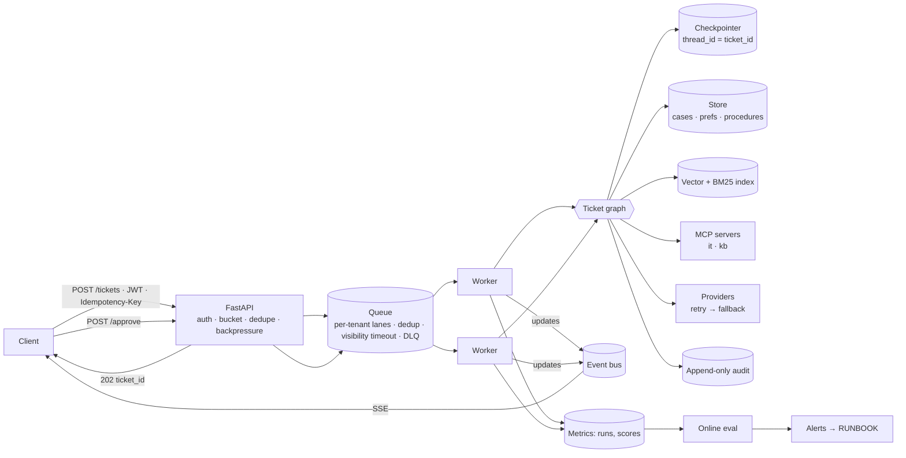

# ATLAS — Architecture

ATLAS is an adaptive operations copilot for a 400-person logistics company. It answers questions from internal
documents, resolves tickets by calling internal systems through MCP, follows policy-as-code, learns from feedback, and
runs as a queue-backed multi-tenant service.

## The eight layers

| # | Layer | What it holds | Code | Phase |
|---|---|---|---|---|
| 1 | Model access | provider clients, structured output, retry/fallback, cost, budget, token gate | `atlas/llm/` | P1 |
| 2 | Knowledge | idempotent ingestion, hybrid retrieval (dense + BM25 + RRF), rerank, rewrite, CRAG | `atlas/rag/` | P2 |
| 3 | Orchestration | LangGraph ticket graph, typed state, interrupts, checkpoints, idempotent tools | `atlas/agents/ticket_graph.py` | P3 |
| 4 | Integration | MCP servers (`atlas-it` HTTP+JWT, `atlas-kb` stdio), governed client | `atlas/mcp/` | P4 |
| 5 | Adaptation | episodic/procedural/semantic memory, reflection, semantic router, tool RAG, supervisor, optimizer | `atlas/agents/` | P5 |
| 6 | Control | guards (input/retrieval/output), policy engine, PII, injection, audit, erasure, residency | `atlas/governance/` | P6 |
| 7 | Operations | evals, judges, CI gate, registry, online eval, telemetry, rollout, dashboard | `evals/`, `atlas/ops/` | P7 |
| 8 | Platform | FastAPI, fair queue, stateless workers, breakers, buckets, caches, IaC | `atlas/api/`, `infra/` | P8 |

## Request flow



## The ticket graph

```
START → guard_input → route ─┬─ escalate ───────────────────────────────┐
                             ├─ faq ─(answered)──────────────────────────┤
                             └─ triage ─┬─ hr → escalate                 │
                                        └─ retrieve → guard_retrieval    │
                                           → recall → plan ⇄ reflect(≤2) │
                                           ─┬─ approval (interrupt) ─────┤
                                            ├─ execute ──────────────────┤
                                            └─ respond ──────────────────┤
                         respond / escalate / faq → guard_output → finalize → END
```

The set of reachable transitions lives in `build()`, in code. The model only picks among them. Every conditional
edge lists its targets explicitly, so the graph can be drawn and audited from that one function.

**Capability separation:** the planner emits a small step DSL (`READ:` / `CALL:` / `ANSWER:`). It cannot call tools
directly. `execute` parses each step and asks the policy engine. Tenant and idempotency keys are injected by code,
real values are restored from pseudonyms by code, and writes need a human approval interrupt.

## Key design decisions

| Decision | Why | Consequence you design for |
|---|---|---|
| `thread_id = ticket_id` | the ticket is the unit of work and approval | users have many tickets; never key by user |
| Stateless workers + durable checkpoints | horizontal scale, crash recovery, zero-drain deploys, day-long approvals | a node may re-run on resume, so every write takes an idempotency key `(ticket_id, step)` |
| Plan DSL instead of free tool calling | capability separation; auditable plans; policy checks per step | the planner must be good at the DSL (critique catches malformed steps) |
| Reversible pseudonymization at input | the model never sees raw PII; tools still get real targets | the mapping lives only in checkpoint state, which is covered by retention and erasure |
| Routing table, prompts, retrieval config are data (`prompts/active.yaml`) | the P7 registry can promote or roll back without a deploy | every change must pass the gate first |
| Deny-by-default policy file, hot-reloaded | kill switches take effect immediately | evaluator is unit-tested like code |

## Failure modes

| Component | Failure | Detection | Mitigation | Runbook |
|---|---|---|---|---|
| Provider | 429 storm / outage | provider error rate; breaker state on `/healthz` | retry with backoff → fallback provider → circuit breaker → "queued for a colleague" | RB-01 |
| Worker | crash mid-graph | message redelivery after visibility timeout | resume from last checkpoint; idempotent writes | RB-02 |
| Queue | depth spike (tenant bulk) | depth per tenant lane; CloudWatch alarm | round-robin lanes; API 429 backpressure | RB-03 |
| Cache | stale answer after prompt change | key includes prompt + retrieval version | versioned keys; TTL; semantic hits audited and judged | RB-04 |
| MCP server | down / slow | `ServerUnavailable`; tool errors | graph degrades to "queued for human" | RB-05 |
| Postgres | failover | connection errors | Aurora multi-AZ; retries; checkpoints make work resumable | RB-06 |
| Quality | judge pass rate drops | online eval drift alert | rollback via registry; check provider fingerprint | RB-07 |
| PII | leak in output | `no_pii` online score; output guard blocks | block, not redact; incident process | RB-08 |
| Escalations | rate doubles | online eval alert | check router / triage prompt changes | RB-09 |
| Canary | candidate worse than stable | online scores per variant; $/ticket | weight back to 0; `registry rollback` | RB-10 |

## SLOs (targets to measure against in P8)

| Route | p95 latency | Quality (judge pass) | Cost |
|---|---|---|---|
| faq (sync) | < 3 s | grounded ≥ 0.95 | < $0.002 / query |
| ticket (async) | < 60 s to approval or resolution | right_tools ≥ 0.95, grounded ≥ 0.9 | < $0.02 / ticket |
| escalate | < 5 s to hand-off | right_escalate ≥ 0.98 | ≈ $0 |

## Cost model

`$ per ticket = Σ LLM calls × price + embeddings/rerank + infra per ticket`. The offline gate reports
`usd_per_ticket` at simulated gpt-4.1-mini prices: currently **≈ $0.0009** across the golden set, with
6–7 calls on a write ticket (triage, plan, critique, respond, grounding judge, and others). Optimize in this order:
cache the FAQ route → route more traffic to the cheap model (with eval proof) → provider prompt caching → trim
context → use a smaller reranker → batch offline work.

## Scaling limits (what breaks first)

1. **In-memory BM25 + brute-force vectors**: fine for about 100k chunks. Beyond that, use OpenSearch or
   pgvector + tsvector with filters inside the engine.
2. **Local adapters** (SQLite checkpoints/store/audit, in-memory queue/bus): one process only. Production:
   PostgresSaver/PostgresStore, SQS FIFO, Redis Streams (see `infra/docker-compose.yml`).
3. **Provider TPM limits**: per-model token buckets and the breaker matter before CPU does. Autoscale workers on
   queue depth, not CPU.
