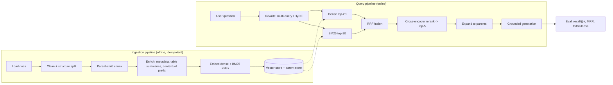

# Phase 2 — RAG that survives contact with users (Week 2)

## The goal

> **By the end of Week 2, `v0.2` exists: a tenant-aware, idempotent ingestion pipeline; hybrid retrieval with RRF and a reranker; query rewriting; a 40-row golden set; a four-configuration eval table with recall@5, MRR, and faithfulness; and a written decision on which configuration ATLAS runs — chosen from the numbers, not from taste.**

## Mental model

RAG is **a search engine with an LLM as the summarizer**. Google's quality comes from ranking, not from the snippet writer. If the top-5 chunks are wrong, no prompt saves you. So the whole discipline is: *measure retrieval in isolation first; touch generation last.*



## Concepts — what you must actually understand

### Ingestion is a data pipeline, not a script
Load → clean → split → enrich → embed → upsert. Three properties make it production-grade:
- **Idempotent**: content-hash IDs; re-running never duplicates.
- **Incremental**: a manifest of `(path, sha256)`; unchanged files skip, changed files re-index, deleted files purge.
- **Observable**: counts per stage, embedding cost per run, failures per doc. Log it like any ETL.

### Chunking is a product decision
The chunk is both the unit of *matching* and the unit of *reading*. Those want different sizes, so use **parent–child**: index small children (≈300–500 tokens) for tight matching, return the parent section for context. Split on structure (headers, list boundaries) before character counts. Tables stay whole with an LLM-written one-line summary in metadata so they're findable.

**2026 upgrades you should know and try one of:**
- **Contextual chunk enrichment** (Anthropic's "contextual retrieval"): prepend to each chunk a short LLM-written line situating it in the document ("This section of the VPN policy covers split-tunnelling exceptions for contractors"). Big recall wins on pronoun-heavy docs; costs an LLM call per chunk at index time — use prompt caching on the full document.
- **Late chunking**: embed the whole document with a long-context embedding model first, *then* pool token embeddings per chunk, so each chunk vector carries surrounding context without the LLM cost. Cheaper than contextual retrieval; needs a model that supports it (Jina-style).
- **Late interaction / multi-vector (ColBERT-family)**: one vector per token, MaxSim scoring. Consistently stronger than single-vector on hard queries; storage cost mitigated by token pooling. Worth a benchmark on your golden set once the baseline is solid.
- **Visual document retrieval (ColPali-style)**: embed page *images*; skip OCR for slide decks and scanned forms. Not for ATLAS week 2, but know it exists for the "our runbooks are PDFs of screenshots" client.

### Hybrid retrieval and fusion
Dense retrieval captures meaning and misses strings: error codes, names, SKUs, policy numbers. **BM25** nails strings and misses paraphrase. Run both, fuse with **Reciprocal Rank Fusion** — score = Σ 1/(k + rank) over lists, k≈60. No tuning, robust, standard. Filters (tenant, access level, date) apply *inside* both retrievers, never after — post-filtering a top-20 can leave you with zero results.

### Reranking is the highest-ROI upgrade
First-stage retrievers score query and document separately (bi-encoder). A **cross-encoder** reads them together and scores real relevance. Retrieve top-20 cheaply, rerank to top-5 accurately. Options: local cross-encoder (`sentence-transformers`, e.g. a bge-reranker or mxbai-rerank model), hosted rerank APIs (Cohere, Voyage), or an LLM doing listwise reranking (strong, slow, expensive — good as a ceiling to compare against).

### Query rewriting closes the vocabulary gap
Users write vaguely; docs are precise. **Multi-query** (3 paraphrases, union, RRF), **HyDE** (draft a hypothetical answer, embed *that*), **step-back** (ask the general question first), **decomposition** (split multi-part questions). All one structured-output call each. Measure; keep the ones that move recall.

### Agentic retrieval — when the retriever becomes a loop
Static "retrieve once, answer" fails on multi-hop questions ("which policy applies to a contractor on VPN from Austria?"). **Corrective RAG** grades retrieved chunks and re-retrieves with a rewritten query if they're poor. **Agentic RAG** lets the model decide whether to search at all, what to search, and when to stop — a LangGraph loop with retrieval as a tool, bounded by a step limit. Build the corrective version this week as a graph; you'll reuse the pattern in Phase 3.

### GraphRAG and knowledge graphs — recognize, don't build yet
For "who reports to whom", "which systems depend on X", entity-relationship questions, a graph index (entities + relations extracted by an LLM, community summaries) beats chunks. Expensive to build, hard to keep fresh. Know the trade-off; propose it only when the golden set shows multi-hop failures that hybrid + rerank can't fix.

### Evaluate retrieval and generation separately
- **Retrieval**: recall@k (did a relevant chunk appear in top-k?), MRR (how high?), nDCG if you have graded relevance. You write these — 20 lines.
- **Generation**: faithfulness (claims supported by context?), answer relevance, context precision/recall. **RAGAS** computes them with an LLM judge; understand each metric's judge prompt before trusting it.
- **Decision rule**: low recall → fix retrieval, don't touch the prompt. High recall + low faithfulness → generation problem. High everything + unhappy users → your golden set doesn't match real queries.

### The golden set is your most valuable asset
40 rows now: 25 hand-written from your corpus, 15 synthetic (LLM writes a question per chunk; you verify each). Each row: `question`, `relevant_chunk_ids`, `reference_answer`, `type` (factoid / procedural / multi-hop / exact-token). The `type` column lets you see *which kind* of question each config wins. It grows weekly from Phase 7 on.

### Semantic caching
Exact-match caching misses "how do I reset VPN" vs "VPN reset steps". A semantic cache embeds the query, returns a cached answer above a similarity threshold. Massive cost win on FAQ traffic, dangerous if thresholds are loose (wrong answer served confidently) or if cache keys ignore tenant/prompt version. Build it in Phase 8; design the key now: `(tenant, prompt_version, embedding)`.

## Resources (ranked, with what to extract)

| # | Resource | Time | Extract |
|---|---|---|---|
| 1 | **Jason Liu — "Systematically Improving RAG Applications"** (jxnl.co, free) | 2 h | leading vs lagging metrics; synthetic question generation; segmenting queries by type; feedback loops |
| 2 | **Anthropic — "Introducing Contextual Retrieval"** (engineering blog) | 30 m | the enrichment prompt; the measured recall gains; why prompt caching makes it affordable |
| 3 | **Jina — "Late Chunking" paper/blog** | 40 m | the pooling trick; when it beats contextual retrieval on cost |
| 4 | **Hamel's notes on the modern retrieval talk series** (Clavié, Thakur, Chaffin) | 1.5 h | retrieval is IR with 30 years of prior art; late interaction; how IR people evaluate |
| 5 | **LangChain docs → Retrieval, Text splitters, `langchain-chroma`; LangGraph tutorials → Agentic RAG / Corrective RAG** | 1.5 h | API only; the CRAG graph shape |
| 6 | **RAGAS docs → metrics** | 45 m | how faithfulness and context precision are *computed*; their judge prompts |
| 7 | **"Lost in the Middle"** (paper, skim) | 20 m | position effects; why top-5 beats top-15 |
| 8 | Optional: **ColBERT / PLAID and RAGatouille README**; **ColPali** blog | 1 h | multi-vector mechanics; when visual retrieval is the right call |

## Milestones

| Milestone | Deliverable | Done when |
|---|---|---|
| **M2.1 Corpus** | `data/corpus/` — 200+ pages of realistic internal docs (IT policies, HR handbook, runbooks, 100 past tickets) | `uv run scripts/corpus_stats.py` prints doc/page/token counts |
| **M2.2 Ingest** | `atlas/rag/ingest.py` + manifest | second run adds 0 vectors; editing one doc re-indexes only that doc |
| **M2.3 Hybrid + rerank** | `retrieve.py` with dense, BM25, RRF, reranker, parent expansion | `uv run scripts/ask.py "error E-4471"` returns the right parent |
| **M2.4 Rewrite** | `rewrite.py` multi-query + HyDE | both produce 3/1 outputs via structured output |
| **M2.5 Golden set** | `evals/datasets/rag_golden_v1.jsonl`, 40 rows typed | schema-validated; every relevant_id exists in the index |
| **M2.6 Eval harness** | `evals/rag_eval.py` recall@5, MRR, faithfulness | writes `evals/results/rag_<config>.json` for four configs |
| **M2.7 Corrective RAG graph** | `atlas/rag/crag.py` LangGraph loop, max 2 retries | multi-hop golden questions improve vs. static |
| **M2.8 Decision + ship** | write-up #2 with the table, tag `v0.2` | config chosen with cost/latency stated |

## Day-by-day

| Day | Build (3 h) | Learn (2 h) | Write (1 h) |
|---|---|---|---|
| Mon | M2.1 corpus (generate with an LLM from a schema of doc types; make it messy: duplicates, a stale draft, tables) | R1 | goal sentence; map from memory |
| Tue | M2.2 ingest + manifest + parent store | R2, R3 | notes: parent–child in your words |
| Wed | M2.3 hybrid + RRF + local reranker | R4 | notes: why filters go inside retrievers |
| Thu | M2.4 rewrite; M2.5 golden set (hand rows) | R5, R6 | notes: recall vs faithfulness decision rule |
| Fri | M2.6 harness; run four configs | R7 | checkpoint questions |
| Sat | M2.7 CRAG graph; synthetic golden rows; rerun | R8 | write-up draft with table |
| Sun | break-it drills, decide config, tag | — | publish |

## Lab

### `atlas/rag/ingest.py`
```python
import hashlib, json
from pathlib import Path
from langchain_text_splitters import MarkdownHeaderTextSplitter, RecursiveCharacterTextSplitter
from langchain_core.documents import Document
from atlas.rag.stores import vectors, parents, manifest     # thin wrappers: Chroma, Postgres/JSON, JSON

def cid(s: str) -> str: return hashlib.sha256(s.encode()).hexdigest()[:20]

HEADERS = MarkdownHeaderTextSplitter([("#", "h1"), ("##", "h2"), ("###", "h3")])
CHILD   = RecursiveCharacterTextSplitter(chunk_size=450, chunk_overlap=60)
TABLE_RE = r"(?ms)^\|.*?\n(?:\|.*?\n)+"

def contextualize(doc_text: str, chunk: str) -> str:
    """Anthropic-style contextual prefix. One structured-output call; cache the doc as prompt prefix."""
    from atlas.llm.client import short_context   # you write: returns one sentence situating the chunk
    return short_context(doc_text, chunk)

def ingest_file(path: Path, tenant: str, *, contextual: bool = False) -> dict:
    text = path.read_text(); sha = cid(text)
    if manifest.get(str(path)) == sha: return {"skipped": True}
    manifest.purge(str(path))                       # removes old vectors/parents for changed files
    stats = {"parents": 0, "children": 0}
    for parent in HEADERS.split_text(text):
        pid = cid(parent.page_content + str(path))
        parents.put(pid, parent.page_content, meta={**parent.metadata, "source": str(path), "tenant": tenant})
        stats["parents"] += 1
        pieces = split_keeping_tables(parent.page_content)     # tables stay whole
        for piece in pieces:
            for c in CHILD.split_text(piece):
                body = f"{contextualize(text, c)}\n{c}" if contextual else c
                vectors.add(Document(page_content=body, metadata={
                    "parent_id": pid, "source": str(path), "tenant": tenant, "is_table": piece.startswith("|"),
                    **parent.metadata}), id=cid(body + pid))
                stats["children"] += 1
    manifest.set(str(path), sha)
    return stats
```

### `atlas/rag/retrieve.py`
```python
from dataclasses import dataclass
from rank_bm25 import BM25Okapi
from sentence_transformers import CrossEncoder

def rrf(rankings: list[list[str]], k: int = 60) -> list[str]:
    s: dict[str, float] = {}
    for r in rankings:
        for i, id_ in enumerate(r): s[id_] = s.get(id_, 0.0) + 1.0 / (k + i)
    return sorted(s, key=s.get, reverse=True)

@dataclass
class Hit: id: str; text: str; parent_id: str; score: float; source: str

class HybridRetriever:
    def __init__(self, vectors, bm25_index, parents, reranker: CrossEncoder | None):
        self.v, self.bm, self.p, self.rr = vectors, bm25_index, parents, reranker

    def retrieve(self, query: str, tenant: str, *, k_first=20, k_final=5, rewrite=None) -> list[Hit]:
        queries = [query] + (rewrite(query) if rewrite else [])
        lists = []
        for q in queries:
            lists.append([d.id for d in self.v.similarity_search(q, k=k_first, filter={"tenant": tenant})])
            lists.append(self.bm.top(q, k=k_first, tenant=tenant))         # BM25 with tenant filter inside
        fused = rrf(lists)[:k_first]
        cands = [(i, self.v.text(i)) for i in fused]
        if self.rr:
            scores = self.rr.predict([(query, t) for _, t in cands])
            cands = [c for c, _ in sorted(zip(cands, scores), key=lambda x: -x[1])]
        seen, out = set(), []
        for i, t in cands:
            pid = self.v.meta(i)["parent_id"]
            if pid in seen: continue
            seen.add(pid)
            out.append(Hit(i, self.p.get(pid), pid, 0.0, self.v.meta(i)["source"]))
            if len(out) == k_final: break
        return out
```

### `atlas/rag/rewrite.py`
```python
class Paraphrases(BaseModel): queries: list[str] = Field(min_length=3, max_length=3)
class Hypothetical(BaseModel): answer: str

def multi_query(q: str) -> list[str]: return rewrite_llm.with_structured_output(Paraphrases).invoke(MQ_PROMPT.format(q=q)).queries
def hyde(q: str) -> list[str]:        return [rewrite_llm.with_structured_output(Hypothetical).invoke(HYDE_PROMPT.format(q=q)).answer]
```

### `atlas/rag/crag.py` — corrective RAG as a LangGraph loop
```python
class RagState(TypedDict, total=False):
    question: str; tenant: str; hits: list[Hit]; grade: str; attempts: int; answer: str

def retrieve_node(s):  return {"hits": retriever.retrieve(s["question"], s["tenant"]), "attempts": s.get("attempts", 0) + 1}
def grade_node(s):     return {"grade": grader.invoke(GRADE_PROMPT.format(q=s["question"], ctx=s["hits"])).label}  # "good" | "poor"
def rewrite_node(s):   return {"question": rewriter.invoke(REWRITE_PROMPT.format(q=s["question"])).query}
def answer_node(s):    return {"answer": answerer.invoke(ANSWER_PROMPT.format(q=s["question"], ctx=s["hits"]))}
def route(s):          return "answer" if s["grade"] == "good" or s["attempts"] >= 2 else "rewrite"

g = StateGraph(RagState)
g.add_node("retrieve", retrieve_node); g.add_node("grade", grade_node)
g.add_node("rewrite", rewrite_node);   g.add_node("answer", answer_node)
g.add_edge(START, "retrieve"); g.add_edge("retrieve", "grade")
g.add_conditional_edges("grade", route); g.add_edge("rewrite", "retrieve"); g.add_edge("answer", END)
crag = g.compile()
```

### `evals/rag_eval.py`
```python
def recall_at_k(ret: list[str], rel: list[str], k=5) -> float: return len(set(ret[:k]) & set(rel)) / len(rel)
def mrr(ret: list[str], rel: list[str]) -> float:
    for i, r in enumerate(ret):
        if r in rel: return 1 / (i + 1)
    return 0.0

CONFIGS = {"dense": ..., "hybrid": ..., "hybrid+rerank": ..., "hybrid+rerank+mq": ...}
for name, cfg in CONFIGS.items():
    rows = [run(cfg, row) for row in golden]          # returns retrieved parent ids + generated answer
    summary = {"recall@5": mean(recall_at_k(r.ids, row.rel) for r, row in zip(rows, golden)),
               "mrr": mean(...), "by_type": per_type(...), "p95_ms": p95(...), "usd_per_query": mean(...)}
    summary["faithfulness"] = ragas_faithfulness(rows, golden)      # RAGAS, judge model pinned
    write(f"evals/results/rag_{name}.json", summary)
```

## Level 2 — advanced extensions (do at least one)
1. **Contextual retrieval on/off** as a fifth config. Report recall delta and index cost.
2. **Late-interaction reranker** (a ColBERT-family model via RAGatouille or a native library) vs. the cross-encoder. Same golden set.
3. **Access-aware retrieval**: add `access_level` metadata; a `helpdesk` user must never retrieve `it_admin` docs. Write the CI test now; Phase 6 will cite it.
4. **Freshness boost**: two versions of the VPN policy in the corpus; the retriever must prefer the current one. Metadata `effective_from` + a boost in fusion.

## Break it
1. Ingest a doc with a table; ask what only the table answers. Fails? Fix with table-aware chunking; re-measure.
2. "What does error E-4471 mean?" dense-only vs hybrid. Record the delta.
3. Run ingest twice; count vectors. Doubled → IDs aren't content-derived.
4. Put the answer in position 8 of 10 chunks. Does the model find it? Now you know why k=5.
5. Query as tenant B for tenant A's doc. Anything leak? Make it a test.
6. Keep the 2023 draft and the 2026 policy both indexed. Which does the model cite? Fix with freshness metadata.

## Checkpoint
1. Recall@5 = 0.92, users say answers are wrong. Next metric, two likely fixes.
2. When do you skip reranking?
3. Why does parent–child help both retrieval *and* generation?
4. Corpus grows to 50k docs and BM25 lives in memory. What breaks; what replaces it?
5. Contextual retrieval vs late chunking — pick one for a 10k-page corpus that changes daily. Why?
6. Why must tenant filters run inside the retriever rather than after fusion?

**Task:** the four-config table (plus your Level 2 config) with recall@5, MRR, faithfulness, p95, $/query, and a paragraph choosing ATLAS's config on numbers + cost.

<details><summary>Answer key</summary>

1. Faithfulness. If low: tighten grounding instructions, "answer only from context or say you can't", check context order. If faithfulness is high too, your golden set doesn't reflect real queries — sample production questions.
2. Tiny corpus, sub-300 ms budgets, or first-stage recall already near-perfect on the golden set. Justify reranking with the measured delta.
3. Small children rank precisely (better recall@k); the returned parent gives the model surrounding context (better faithfulness, fewer partial answers).
4. Memory, rebuild time, awkward per-tenant filtering. Replace with an engine that does BM25 + filters natively (OpenSearch/Elasticsearch, or Qdrant/Weaviate/pgvector+tsvector with sparse support).
5. Late chunking: no per-chunk LLM cost, so daily re-indexing stays cheap; contextual retrieval's LLM call per chunk is only affordable with heavy caching and infrequent changes.
6. Post-filtering a top-20 can leave zero results for a small tenant, and it wastes the top-k budget on other tenants' chunks; filtering inside guarantees k relevant, permitted candidates.
</details>

## Write-up #2
Title idea: *"Measure retrieval first: four RAG configs on one golden set."* The table, one chart (recall@5 by query type per config), the tenant-leak test, the config decision with $/query.

## Gate
**"I build idempotent, tenant-aware ingestion with hybrid retrieval, reranking, query rewriting, and a corrective retrieval loop — and I choose configurations from measured recall, faithfulness, latency, and cost."** → `git tag v0.2`
