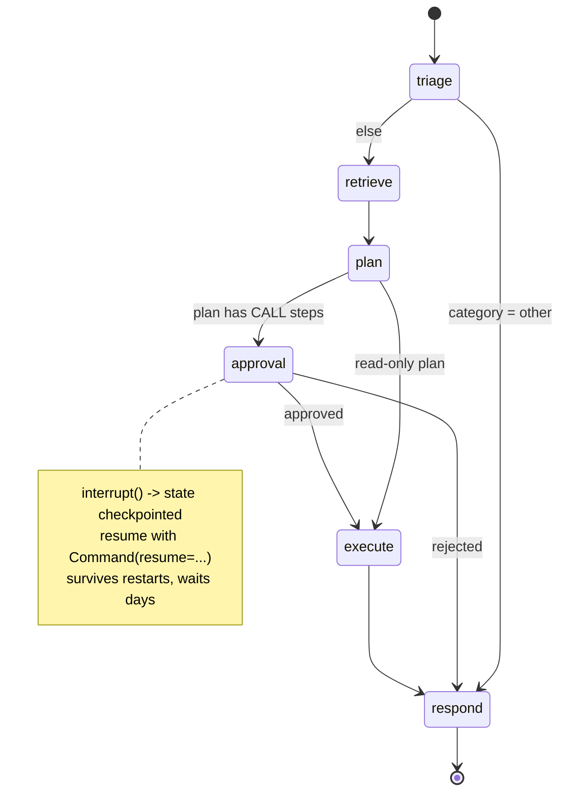

# Phase 3 — Agents as durable state machines (Week 3)

## The goal

> **By the end of Week 3, `v0.3` exists: the ATLAS ticket graph — typed state with reducers, conditional routing, a plan → approval → execute path with a human interrupt that survives a process restart, idempotent tools, context compaction, streaming, and tests that assert routing per ticket type.**

## Mental model

An agent is **a workflow engine where some transitions are decided by an LLM**. You define the states and the allowed transitions; the model fills in the blanks. If you can't draw the graph, you don't have an agent — you have a while-loop with hope.

Anthropic's ladder, from cheapest to most autonomous: augmented LLM → prompt chaining → routing → parallelization → orchestrator–workers → evaluator–optimizer → autonomous agent. Climb only as high as the task needs. ATLAS lives on rungs 3–5 with one bounded autonomous step (execute).



## Concepts

### State is the single source of truth
A `TypedDict`/Pydantic model. Nodes read it and return *partial updates*. **Reducers** decide how updates merge: `Annotated[list, add_messages]` appends and de-duplicates by id; a custom reducer can cap length or merge dicts. Nothing in globals, nothing in closures — that's what makes runs resumable, inspectable, replayable, and testable.

### Nodes, edges, and the safety property
A node is `state → partial state`. Edges are static or conditional (a function returning the next node's name, or a `Command`). The set of reachable transitions is fixed by *you*; the model only picks among them. That fixed set is a safety property you can audit from the graph definition alone — no reading prompts required.

### Durable execution
LangGraph's 1.x promise: the agent survives a restart. Every super-step's state is checkpointed under a `thread_id`; a crash resumes from the last completed step; approvals can wait for days. Consequences you design for: (a) a node that failed *re-runs* on resume, so side-effecting tools must be idempotent; (b) long-running work must be split into nodes small enough that re-running one is cheap; (c) `thread_id` is an identity decision — for ATLAS, `thread_id = ticket_id`.

### Checkpointers and time travel
`InMemorySaver` for tests, `PostgresSaver` for real. `graph.get_state(config)` shows current state; `get_state_history` lists every step; `update_state` edits it; invoking with a past `checkpoint_id` **forks** from that point ("what if it had chosen B?"). Time travel is your debugger and your replay harness for evals.

### Interrupts — human-in-the-loop that actually works
`interrupt(payload)` inside a node pauses, persists, and returns the payload to the caller. A human decides. `graph.invoke(Command(resume=value), config)` continues *at that node*. Patterns: approve/reject a tool call, edit the plan before execution, ask the user a clarifying question, hand off to a human queue. `HumanInTheLoopMiddleware` wraps this for `create_agent` tool calls; in a raw graph you call `interrupt()` yourself. Rule: **every write action passes through an interrupt or an explicit policy allow** (Phase 6).

### `create_agent` and middleware vs raw `StateGraph`
`create_agent` (LangChain 1.x) is the standard tool-calling loop with **middleware** as its extension surface — hooks before/after the model call and around tool calls; prebuilt: summarization, PII, HITL, tool-call limits, model fallbacks. Use it for the *execute* step. Use `StateGraph` when control flow isn't "loop until done": branches, approval gates, fan-out/fan-in, plan-then-act. ATLAS uses both, and the executor is a node inside the ticket graph.

### Tools that don't hurt you
- The docstring *is* the prompt. Vague docstring → wrong tool picks.
- Typed args (Pydantic) with descriptions; enums for anything enumerable.
- Return compact, structured results; never dump 5 MB into context.
- Idempotency key on every write; the graph passes `f"{ticket_id}:{step}"`.
- Errors: recoverable ones (user not found) return as observations so the model can adapt; infrastructure/security failures raise and halt.
- `ToolCallLimitMiddleware` / `recursion_limit` bound the loop.

### Context engineering, applied
Message lists grow; quality and cost degrade. Anthropic's frame: context is a finite attention budget. Tactics: compaction (summarize past N tokens, keep last k turns intact — `SummarizationMiddleware` or your own node), trim tool outputs, put retrieved context in just-in-time rather than front-loading, keep a structured scratchpad in state instead of in prose, isolate subgraphs so the parent carries a summary not the transcript.

### Streaming
Modes: `values` (full state per step), `updates` (deltas), `messages` (token stream from LLM calls), `custom` (your own events via `get_stream_writer`). Chat UIs consume `messages`; ops dashboards consume `updates`; Phase 8 publishes `updates` to a Redis stream.

### Subgraphs and `Command`
A compiled graph is a node. `Command(goto=..., update=...)` updates state and picks the next node in one return — the handoff primitive for Phase 5's supervisor. Subgraphs get their own scoped state schema; map in/out explicitly.

### Failure modes to design for
Runaway loops (limits), replayed side effects (idempotency), state schema drift (typed state + tests), tool errors swallowed as prose (structured error returns), unbounded context (compaction), lost approvals (durable interrupts), non-deterministic routing (structured output on routing decisions, `Literal` targets).

## Resources

| # | Resource | Time | Extract |
|---|---|---|---|
| 1 | **LangChain Academy — Intro to LangGraph, modules 1–3** (free) | 5 h | graphs, state, reducers, checkpointers, HITL, streaming — do the notebooks |
| 2 | **Anthropic — "Building effective agents"** | 40 m | the workflow ladder; "start simple, add autonomy only when measured" |
| 3 | **LangGraph docs → Concepts: Persistence, Durable execution, Interrupts, Time travel, Streaming, Subgraphs** | 2 h | read concept pages fully |
| 4 | **LangChain 1.x docs → `create_agent`, Middleware catalogue, Guardrails** | 1 h | hook points; prebuilt middleware list |
| 5 | **Anthropic — "Effective context engineering for AI agents"** | 40 m | attention budget; compaction; just-in-time retrieval; structured notes |
| 6 | **Anthropic — "Effective harnesses for long-running agents"** | 30 m | progress files; resumable work units — you'll reuse in Phase 5 |
| 7 | Optional: **Coursera/IBM Agentic AI with LangChain & LangGraph** — ReAct/Reflection module | 2 h | a second explanation if the loop mechanics don't stick |

## Milestones

| Milestone | Deliverable | Done when |
|---|---|---|
| **M3.1 State + graph** | `state.py`, `ticket_graph.py` with all six nodes and routing | `langgraph dev` shows the graph; a ticket runs end-to-end |
| **M3.2 Executor** | `create_agent` with tools + middleware (limits, summarization) | plan with 3 read-only steps executes; loop bounded |
| **M3.3 Durable approval** | `approval` interrupt + resume | kill process at approval, restart, resume → completes |
| **M3.4 Idempotent tools** | keys threaded through state | crash mid-execute + resume → reset sent once (test) |
| **M3.5 Compaction** | summarize node/middleware > 6k tokens | 40-turn thread stays under budget; last 4 turns intact |
| **M3.6 Streaming** | `scripts/watch.py` streams `updates` + `messages` | node-by-node progress printed live |
| **M3.7 Tests** | `tests/test_graph.py` with fake LLM + `InMemorySaver` | routing asserted per category; interrupt asserted on CALL plans; idempotency asserted |
| **M3.8 Ship** | write-up #3 with the state diagram; tag `v0.3` | — |

## Day-by-day

| Day | Build | Learn | Write |
|---|---|---|---|
| Mon | M3.1 state + skeleton graph, `langgraph dev` | R1 (mod 1–2) | draw the graph before coding |
| Tue | M3.1 finish; M3.2 executor with middleware | R1 (mod 3), R4 | notes: reducer semantics |
| Wed | M3.3 interrupt + Postgres saver; restart test | R3 | notes: durable execution consequences |
| Thu | M3.4 idempotency; M3.5 compaction | R5, R6 | notes: context budget tactics |
| Fri | M3.6 streaming; M3.7 tests | R2 | checkpoint questions |
| Sat | time-travel/fork experiment; break-it drills | R7 | write-up draft |
| Sun | polish, tag | — | publish |

## Lab

### `atlas/agents/state.py`
```python
from typing import Annotated, Literal, TypedDict
from langgraph.graph.message import add_messages

Category = Literal["billing", "access", "bug", "hr", "other"]

def cap(existing: list, new: list, limit: int = 50) -> list:      # custom reducer: keep last N tool results
    return (existing + new)[-limit:]

class TicketState(TypedDict, total=False):
    messages: Annotated[list, add_messages]
    tool_results: Annotated[list[dict], cap]
    tenant: str; user_id: str; user_role: str
    ticket_id: str; ticket_text: str
    triage: dict
    context: list[dict]
    plan: list[str]                # "READ: lookup_user(email=...)" | "CALL: reset_password(email=...)"
    approved: bool | None
    resolution: str
    step: int
```

### `atlas/agents/ticket_graph.py`
```python
from langgraph.graph import StateGraph, START, END
from langgraph.types import interrupt, Command
from langgraph.checkpoint.postgres import PostgresSaver
from langchain.agents import create_agent
from langchain.agents.middleware import SummarizationMiddleware, ToolCallLimitMiddleware
from atlas.llm.client import triage
from atlas.rag.retrieve import retriever
from atlas.agents.tools import TOOLS
from atlas.agents.plan import make_plan, write_resolution

def triage_node(s):   return {"triage": triage(s["ticket_text"], tags=[f"tenant:{s['tenant']}"]).model_dump()}
def retrieve_node(s): return {"context": [h.__dict__ for h in retriever.retrieve(s["ticket_text"], s["tenant"])]}
def plan_node(s):     return {"plan": make_plan(s["ticket_text"], s["context"], s["triage"])}

def approval_node(s):
    decision = interrupt({"ticket_id": s["ticket_id"], "plan": s["plan"], "triage": s["triage"]})
    return {"approved": decision == "approve"}

executor = create_agent(
    model="gpt-4.1-mini", tools=TOOLS, system_prompt=open("prompts/executor.v1.md").read(),
    middleware=[ToolCallLimitMiddleware(run_limit=8), SummarizationMiddleware(model="gpt-4.1-mini", max_tokens_before_summary=6000)],
)
def execute_node(s):
    keyed = "\n".join(f"{p}  [idempotency_key={s['ticket_id']}:{i}]" for i, p in enumerate(s["plan"]))
    out = executor.invoke({"messages": [("human", f"Execute exactly these steps:\n{keyed}")]},
                          config={"recursion_limit": 20, "tags": [f"ticket:{s['ticket_id']}"]})
    return {"messages": out["messages"], "tool_results": extract_tool_results(out["messages"])}

def respond_node(s):  return {"resolution": write_resolution(s)}

def after_triage(s):   return "respond" if s["triage"]["category"] == "other" else "retrieve"
def after_plan(s):     return "approval" if any(p.startswith("CALL:") for p in s["plan"]) else "execute"
def after_approval(s): return "execute" if s["approved"] else "respond"

def build(checkpointer=None):
    g = StateGraph(TicketState)
    for n, f in [("triage", triage_node), ("retrieve", retrieve_node), ("plan", plan_node),
                 ("approval", approval_node), ("execute", execute_node), ("respond", respond_node)]:
        g.add_node(n, f)
    g.add_edge(START, "triage")
    g.add_conditional_edges("triage", after_triage, ["retrieve", "respond"])
    g.add_edge("retrieve", "plan")
    g.add_conditional_edges("plan", after_plan, ["approval", "execute"])
    g.add_conditional_edges("approval", after_approval, ["execute", "respond"])
    g.add_edge("execute", "respond"); g.add_edge("respond", END)
    return g.compile(checkpointer=checkpointer)
```
Passing the explicit target list to `add_conditional_edges` makes the graph drawable and the allowed transitions auditable.

### `atlas/agents/tools.py`
```python
from langchain_core.tools import tool
from pydantic import BaseModel, Field

class ResetArgs(BaseModel):
    email: str = Field(description="Company email of the user whose password is reset.")
    idempotency_key: str = Field(description="Provided in the plan. Reuse it on retry so a reset is never sent twice.")

@tool(args_schema=ResetArgs)
def reset_password(email: str, idempotency_key: str) -> dict:
    """Send a password-reset link to a company user. Only call when the plan step says CALL: reset_password.
    Returns {"sent": bool, "request_id": str}. If the user does not exist, returns {"error": "user_not_found"}."""
    return it_client.reset(email, key=idempotency_key)       # server dedupes on key (Phase 4 makes this MCP)
```

### Resume from the CLI
```python
cfg = {"configurable": {"thread_id": "t-001"}}
graph.invoke({"ticket_id": "t-001", "ticket_text": "...", "tenant": "acme", "user_role": "it_support"}, cfg)
print(graph.get_state(cfg).next)           # ('approval',)
# kill the process here; restart; then:
graph.invoke(Command(resume="approve"), cfg)
```

### Time travel
```python
hist = list(graph.get_state_history(cfg))
fork_cfg = hist[3].config                                # state after plan
graph.update_state(fork_cfg, {"plan": ["READ: lookup_user(email=...)"]})
graph.invoke(None, fork_cfg)                             # replay from the edited plan
```

### `tests/test_graph.py`
```python
from langgraph.checkpoint.memory import InMemorySaver
from langgraph.types import Command

def test_other_category_skips_retrieval(fake_triage_other, graph_factory):
    g = graph_factory(InMemorySaver())
    out = g.invoke(ticket("spam"), cfg("t1"))
    assert out["resolution"] and "context" not in out

def test_call_plan_interrupts(fake_plan_with_call, graph_factory):
    g = graph_factory(InMemorySaver())
    g.invoke(ticket("reset my password"), cfg("t2"))
    assert g.get_state(cfg("t2")).next == ("approval",)
    g.invoke(Command(resume="approve"), cfg("t2"))
    assert g.get_state(cfg("t2")).next == ()

def test_resume_does_not_repeat_side_effect(fake_reset_tool, crash_after_first_call, graph_factory):
    ...  # run → crash mid-execute → resume → fake_reset_tool.calls == 1 (same key deduped)
```

## Level 2 — advanced extensions
1. **Parallel fan-out**: `retrieve` fans out to docs + past-tickets retrievers with `Send`, joins with a reducer. Measure latency delta.
2. **Ask-the-user interrupt**: when triage confidence < 0.6, interrupt with a clarifying question; resume with the answer.
3. **Trajectory eval seed**: dump `(inputs, node sequence, tool calls)` for 20 runs into `evals/datasets/trajectories_v0.jsonl` — Phase 7 will judge trajectories, not just outputs.
4. **Deep Agents read**: study the harness (planning tool, sub-agents, file-system memory). Don't adopt; write one paragraph on what ATLAS would gain and lose.

## Break it
1. Kill mid-`execute`, restart, resume. Reset sent twice? → keys.
2. Docstring "does stuff" on one tool. 20 tickets. Wrong picks? Restore; recount.
3. Return an unknown key from a node. Read the error.
4. `recursion_limit=3` with a 5-step plan. Observe cost of a runaway and how the limit saves you.
5. Two tickets, one `thread_id`. What happens? (Thread = identity.)
6. Feed a 40-turn thread without compaction. Cost and quality. Enable compaction; compare.

## Checkpoint
1. Interrupt vs exception — when each; what the checkpointer does differently.
2. 400-message thread, awful latency. Three fixes, cheapest first.
3. Why is a fixed set of conditional-edge targets a *safety* property?
4. Where do tool errors go — raised or returned? Why "it depends"?
5. Why `thread_id = ticket_id` and not `user_id`?
6. What does durable execution force onto tool design?

**Task:** graph from memory, every edge labeled; then the fan-out extension shown in Studio.

<details><summary>Answer key</summary>

1. Interrupt = deliberate pause; state checkpointed at the node; resume continues there. Exception = failure; checkpoint holds the previous step; the failed node re-runs on retry → idempotency.
2. Trim tool outputs / drop old tool messages; summarization past N tokens; subgraphs with scoped state so the parent carries a summary.
3. The model can only choose among transitions you defined; it cannot invent a path to a dangerous node. Auditable from the graph alone.
4. Recoverable (404, bad args) → return as observation so the model self-corrects. Infra/security (auth, policy, critical timeout) → raise, halt, escalate.
5. A ticket is the unit of work and approval; users have many tickets in flight; conflating them corrupts state and approvals.
6. Idempotency keys on writes, compact deterministic returns, and small nodes so a re-run after crash is cheap and safe.
</details>

## Write-up #3
*"Agents that survive restarts: the ATLAS ticket graph."* State diagram, the restart-resume demo, the idempotency test, one time-travel fork.

## Gate
**"I design agents as durable, resumable LangGraph state machines with typed state, human approval gates on writes, idempotent tools, context compaction, streaming, and routing tests."** → `git tag v0.3`
