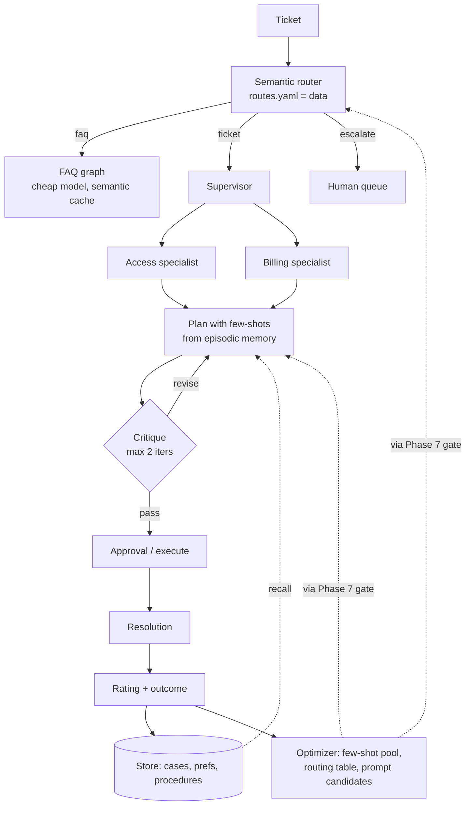

# Phase 5 — Adaptive agents (Weeks 5–6)

## The goal

> **By the end of Week 6, `v0.5` exists: namespaced long-term and episodic memory on the LangGraph Store, a background memory extractor, bounded self-critique, a data-driven semantic router, dynamic tool selection, a supervisor with two specialists, an optimizer that improves a prompt from eval feedback — and a curve proving the agent gets better over 60 tickets.**

## Mental model

A junior employee follows the SOP. A senior one remembers past cases, notices when the first approach isn't working, changes tactics, and asks for help at the right moment. **Adaptive = behavior is a function of history and feedback, not just the current input.** Nothing here changes model weights. The *system* learns; every change is data, auditable and reversible.



## Concepts

### Memory taxonomy (and where each lives)
| Type | What | Where in ATLAS | Written by |
|---|---|---|---|
| Working | current context + graph state | `TicketState` | nodes |
| Short-term | this thread's history | checkpointer | graph |
| Long-term semantic | durable facts about users/tenants | `Store` `(tenant, user, "prefs")` | background extractor |
| Episodic | specific past cases and outcomes | `Store` `(tenant, "cases")` | feedback endpoint |
| Procedural | learned rules ("for Acme, check SSO first") | `Store` `(tenant, "procedures")` + prompt few-shots | extractor + optimizer |

Frameworks to know: **LangMem** (memory tools + background manager for LangGraph), **Letta/MemGPT** (OS-style paging between context and archive), **Mem0**, **Zep** (temporal knowledge graph). Build on the raw Store first; adopt one if it earns its keep in Phase 8.

### Namespaces are a security boundary
Every read/write carries `tenant`; user-scoped memory carries `user_id`. A cross-namespace leak is a data breach. Tests assert isolation; Phase 6 adds retention and erasure per namespace.

### Write policy beats read policy
*When* and *what* gets stored decides whether memory helps or rots. Options: write after every turn (noisy, PII sprawl), write at resolution with a rating (clean, sparse), or a **background extractor** that reads the finished thread and writes structured facts with a schema (LangMem's pattern). ATLAS uses resolution-time episodic writes plus a background extractor for prefs/procedures. Everything stored has a schema, a source trace id, and a TTL.

### Episodic memory = RAG over your own trajectories
Store `(ticket, plan, outcome, rating, route)`. At plan time recall the top-3 *highly rated* similar cases as few-shots; recall one low-rated case as an explicit "avoid" example. The Store's semantic search (embedding index over values) does the retrieval. This is usually what produces the visible curve.

### Reflection, bounded
`plan → critique → (revise | proceed)`; critic uses structured output `{passes, issues, must_fix}`; cap at 2 iterations. Strong models benefit less; measure per route. **Reflexion** is the paper; your episodic store is where its verbal lessons persist across attempts.

### Semantic routing as data
Embed request; compare to route exemplars; nearest wins above a threshold, else default route. The table (`prompts/routes.v1.yaml`) carries graph, model, retrieval profile, and escalation flags. Because it's data, Phase 7's evals can propose changes and the registry can promote them.

### Dynamic tool selection (tool RAG)
Forty tools in context degrade selection accuracy and cost tokens. Embed tool descriptions once; retrieve the 5–8 relevant per request; bind only those. Measure tool-pick accuracy at 40 vs 6.

### Supervisor and handoffs — only when earned
Split when a single graph is unreadable or specialists need separate evals. Supervisor = router node + specialist subgraphs; handoff via `Command(goto=..., update=...)` carrying a compact brief, not the transcript. Multi-agent adds coordination failures; earn it with a measured need. **Deep Agents** (planning tool, sub-agents, file-system memory) is the reference harness for long tasks — study, don't start there.

### Learning from feedback without fine-tuning
Signals: ratings, eval failures, repeated human corrections, escalation outcomes. Targets: few-shot pool, routing table, procedural rules, prompt *candidates*. **Prompt optimization** is now tooling, not folklore: DSPy's optimizers (MIPROv2, GEPA — reflective prompt evolution from execution traces) take a metric + dataset and propose better instructions/demos. ATLAS wires a small optimizer loop: eval failures → candidate prompt → offline gate (Phase 7) → registry. No candidate reaches production without the gate. That's "self-improving" you can defend to a reviewer.

### Context engineering for adaptive agents
Recalled memories compete with retrieved docs for the attention budget. Order: task → constraints → recalled procedures → few-shot cases → retrieved context → history summary. Trim aggressively; the harness from Phase 3 (progress notes in state) keeps long tickets coherent.

## Resources

| # | Resource | Time | Extract |
|---|---|---|---|
| 1 | **LangChain Academy — LangGraph memory modules** (Store, long-term memory, memory schemas) | 3 h | namespaces; semantic search on the Store; schema-driven writes |
| 2 | **LangMem docs** — memory types; background memory manager | 1 h | the extractor pattern even if you roll your own |
| 3 | **Anthropic — "Effective harnesses for long-running agents"** + **`langchain-ai/context_engineering`** | 1.5 h | write/select/compress/isolate; progress files as procedural memory |
| 4 | **Reflexion** (paper) ; **MemGPT** (paper) | 1.5 h | mechanism only |
| 5 | **DSPy docs — Optimizers (MIPROv2, GEPA)**, "Optimize anything" | 2 h | metric + dataset → better prompt; how GEPA uses traces |
| 6 | **LangChain Academy — Deep Agents** | 2 h | after your supervisor works |
| 7 | **Anthropic — "Building effective agents"** (re-read, multi-agent section) | 20 m | coordination cost |
| 8 | Optional: **Letta docs** (memory tiers), **Zep** (temporal KG) | 1 h | what managed memory buys you |

## Milestones

| Milestone | Deliverable | Done when |
|---|---|---|
| **M5.1 Store** | Postgres Store with embedding index; `memory.py` prefs/cases/procedures | put/get/search work; isolation test green |
| **M5.2 Episodic loop** | `/feedback` records rating → `remember_case`; `plan_node` injects recalled cases | few-shots visible in the trace |
| **M5.3 Background extractor** | `extract.py` runs after resolution; writes prefs/procedures with schema + TTL | 10 resolved tickets → sane facts, no PII |
| **M5.4 Reflection** | `reflect.py`, max 2 | loop stops; cost per iteration logged |
| **M5.5 Router** | `router.py` + `routes.v1.yaml` | 30 labelled requests → ≥ 90% correct route |
| **M5.6 Tool RAG** | `tool_select.py` | 40 vs 6 accuracy measured |
| **M5.7 Supervisor** | `supervisor.py` with access + billing specialists | handoff via `Command`; specialist evals separable |
| **M5.8 Optimizer** | `optimize.py`: failures → candidate prompt → gate | one promoted prompt with before/after score |
| **M5.9 Curve** | `evals/adaptive_curve.py` memory on/off over 60 tickets | plot in write-up |
| **M5.10 Ship** | write-up #5; tag `v0.5` | — |

## Day-by-day (two weeks)

| Day | Week 5 | Week 6 |
|---|---|---|
| Mon | M5.1 Store + isolation test · R1 | M5.6 tool RAG measurement · R6 |
| Tue | M5.2 episodic loop · R1 | M5.7 supervisor + handoffs · R7 |
| Wed | M5.3 extractor · R2 | M5.8 optimizer (DSPy) · R5 |
| Thu | M5.4 reflection · R4 | M5.8 gate integration · R5 |
| Fri | M5.5 router · R3 | M5.9 curve experiment |
| Sat | mid-phase break-it drills | break-it drills; checkpoint |
| Sun | notes, rest | write-up, tag |

## Lab

### `atlas/agents/memory.py`
```python
from langgraph.store.postgres import PostgresStore
from langgraph.store.base import BaseStore
from pydantic import BaseModel
from datetime import datetime, timedelta

class Case(BaseModel):
    ticket: str; plan: list[str]; outcome: str; rating: int; route: str; trace_id: str; expires: str

def store_factory(url: str) -> PostgresStore:
    return PostgresStore.from_conn_string(url, index={"embed": embed_fn, "dims": 1536, "fields": ["ticket", "outcome"]})

def recall_cases(store: BaseStore, tenant: str, ticket: str, k=3):
    hits = store.search((tenant, "cases"), query=ticket, limit=k * 3)
    good = [h.value for h in hits if h.value["rating"] >= 4][:k]
    avoid = [h.value for h in hits if h.value["rating"] <= 2][:1]
    return good, avoid

def remember_case(store: BaseStore, tenant: str, ticket_id: str, case: Case):
    store.put((tenant, "cases"), ticket_id, case.model_dump())

def procedures(store: BaseStore, tenant: str, ticket: str, k=3):
    return [h.value["rule"] for h in store.search((tenant, "procedures"), query=ticket, limit=k)]

def prefs(store: BaseStore, tenant: str, user_id: str) -> dict:
    it = store.get((tenant, user_id, "prefs"), "profile"); return it.value if it else {}
```

### `atlas/agents/extract.py` — background memory extractor
```python
class Extraction(BaseModel):
    prefs: dict[str, str] = {}                 # e.g. {"language": "de", "channel": "teams"}
    procedures: list[str] = []                 # "For tenant acme, verify SSO status before MFA resets."
    contains_pii: bool

def extract_and_store(store, thread_messages, tenant, user_id, trace_id):
    x = extractor.with_structured_output(Extraction).invoke(EXTRACT_PROMPT.format(thread=thread_messages))
    if x.contains_pii: return                  # never persist raw PII; Phase 6 redacts upstream
    if x.prefs: store.put((tenant, user_id, "prefs"), "profile", {**prefs(store, tenant, user_id), **x.prefs, "src": trace_id})
    for i, rule in enumerate(x.procedures):
        store.put((tenant, "procedures"), f"{trace_id}:{i}", {"rule": rule, "src": trace_id,
                  "expires": (datetime.utcnow() + timedelta(days=180)).isoformat()})
```
Run it from a post-resolution hook (Phase 8: a queue job).

### `atlas/agents/reflect.py`
```python
class Critique(BaseModel):
    passes: bool; issues: list[str]; must_fix: bool

MAX_ITER = 2
def reflect_node(s):
    c = critic.with_structured_output(Critique).invoke(CRITIQUE_PROMPT.format(
        ticket=s["ticket_text"], plan=s["plan"], context=s["context"], procedures=s.get("procedures", [])))
    return {"critique": c.model_dump(), "iterations": s.get("iterations", 0) + 1}

def after_reflect(s):
    if s["critique"]["passes"] or s["iterations"] >= MAX_ITER:
        return "approval" if any(p.startswith("CALL:") for p in s["plan"]) else "execute"
    return "plan"
```

### `atlas/agents/router.py`
```python
ROUTES = yaml.safe_load(open("prompts/routes.v1.yaml"))
# - {name: faq, examples: [...], graph: faq, model: gpt-4.1-mini, retrieval: docs, min_score: 0.78}
# - {name: ticket, examples: [...], graph: ticket, model: gpt-4.1, retrieval: docs+cases}
# - {name: escalate, examples: [...], graph: human, reasons: [legal, hr_complaint, security_incident]}
_EX = {r["name"]: embed(r["examples"]) for r in ROUTES}
DEFAULT = next(r for r in ROUTES if r["name"] == "ticket")

def route(text: str) -> dict:
    q = embed([text])[0]
    scored = [(max(cos(q, e) for e in _EX[r["name"]]), r) for r in ROUTES]
    score, best = max(scored, key=lambda t: t[0])
    return best if score >= best.get("min_score", 0.75) else DEFAULT
```

### `atlas/agents/tool_select.py`
```python
_TOOL_EMB = {t.name: embed([f"{t.name}: {t.description}"])[0] for t in ALL_TOOLS}
def select(query: str, k=6):
    q = embed([query])[0]
    return sorted(ALL_TOOLS, key=lambda t: -cos(q, _TOOL_EMB[t.name]))[:k]
```

### `atlas/agents/supervisor.py`
```python
from langgraph.types import Command

def supervisor(s) -> Command[Literal["access", "billing", "respond"]]:
    d = sup_llm.with_structured_output(Decision).invoke(SUP_PROMPT.format(ticket=s["ticket_text"], triage=s["triage"]))
    return Command(goto=d.specialist, update={"brief": d.brief})       # compact brief, not the transcript

g = StateGraph(TicketState)
g.add_node("supervisor", supervisor)
g.add_node("access", access_graph)      # compiled subgraphs, own scoped state
g.add_node("billing", billing_graph)
g.add_edge(START, "supervisor"); g.add_edge("access", "respond"); g.add_edge("billing", "respond")
```

### `atlas/agents/optimize.py` — feedback → candidate prompt → gate
```python
import dspy
def propose_candidate(prompt_name: str, failures: list[dict]) -> str:
    """Use DSPy (MIPROv2 or GEPA) with the Phase 7 golden set + failure cases as trainset and the
    'grounded' + 'right_escalate' judges as metric. Returns candidate prompt text; nothing is deployed here."""
    ...
# scripts/optimize.py: writes prompts/<name>.v<N+1>.md and opens a PR; CI eval gate decides.
```

### `evals/adaptive_curve.py`
```python
# replay 60 tickets in order; two runs: memory_on, memory_off; judge each resolution (Phase 7 judge or rubric)
# plot rolling-average pass rate (window 10) for both; save evals/results/adaptive_curve.png
```

## Level 2 — advanced extensions
1. **LangMem** replaces your extractor; compare stored facts quality on the same 10 threads.
2. **Procedural memory injection**: recalled rules enter the plan prompt; measure escalation-rate change on tenant-specific tickets.
3. **Route promotion loop**: the router's per-route pass rate (Phase 7) below threshold → propose model upgrade for that route → gate → registry.
4. **Deep Agents pilot**: rebuild the ticket agent with the Deep Agents harness; write one page comparing control, cost, and observability.

## Break it
1. Rating-1 case recalled as a positive few-shot? Filter or label "avoid".
2. Critic always fails → loop stops at 2; compute uncapped cost per ticket from the log.
3. 40 vs 6 tools on 20 tickets. Numbers.
4. Two users, one tenant: prefs leak? Two tenants: cases leak? Both are CI tests.
5. Poison the routing table with one bad exemplar; measure misroutes.
6. Extractor on a thread containing a phone number. Stored? Must not be.
7. Optimizer proposes a prompt that scores higher on `grounded` but worse on `right_escalate`. Does the gate catch a single-metric regression?

## Checkpoint
1. Memory vs fine-tuning — when each?
2. Why does reflection help less on stronger models; what does that imply for routing?
3. Failure mode of writing memory after every turn?
4. When is a supervisor design *not* worth it?
5. Why must an optimizer's output go through the offline gate rather than straight to production?
6. What's the difference between episodic and procedural memory, and which one generalizes across users?

**Task:** the memory-on vs memory-off curve, plus the 40-vs-6 tool table and one promoted prompt with before/after scores.

<details><summary>Answer key</summary>

1. Memory: per-user/tenant, changes daily, auditable, erasable, no training. Fine-tuning: stable style/format/vocabulary for all users when prompting can't reach it and you can afford the eval/ops burden.
2. Strong models plan near-best first; the critic rarely finds must-fix issues, so the loop is cost without change. Route cheap+reflect or strong+no-reflect, and measure cost per unit quality.
3. Noise, contradictions, PII accumulation, cost, unerasable sprawl. Write at resolution with a rating, or via a schema-driven extractor with TTL.
4. When one graph is still readable, handoff overhead exceeds specialization gains, or specialists can't be evaluated separately yet.
5. An optimizer maximizes the metric it's given and can regress others (over-fit, gaming the judge, unsafe phrasing). The gate runs all judges plus red-team; humans review the diff.
6. Episodic: specific past events (this ticket, this plan, this outcome). Procedural: distilled rules ("for Acme, check SSO first"). Procedural generalizes across users within a tenant; episodic is specific.
</details>

## Write-up #5
*"An agent that gets better with use — and the curve that proves it."* The curve, the tool-selection table, the extractor schema, one promoted prompt diff.

## Gate
**"I build adaptive agents with namespaced long-term, episodic, and procedural memory, a background extractor, bounded self-critique, evidence-driven routing, dynamic tool selection, supervisor handoffs, and an eval-gated prompt optimizer — and I can show the improvement curve."** → `git tag v0.5`
