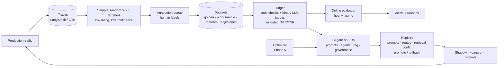

# Phase 7 — LLMOps: the observe → evaluate → change loop (Weeks 9–10)

## The goal

> **By the end of Week 10, `v0.7` exists: 120 traces error-analyzed and categorized; three versioned datasets; failure-specific binary judges validated against human labels (TPR/TNR reported); a CI gate that blocks a deliberately bad PR with a readable score table; a prompt/route registry with promotion and rollback; an online evaluator with a drift alert; OpenTelemetry-compatible telemetry; a per-route dashboard; and a runbook.**

## Mental model

You can't unit-test an LLM system with asserts; you test it with **populations** — datasets, judges, thresholds, trends. LLMOps is a **flywheel**: production traces → sampled & annotated → datasets → validated evaluators → CI gates & online monitors → changes to prompts/routes/retrieval/models → production. Each turn makes the next cheaper. The unit of progress is *a dataset that grew* and *a judge you trust*, not a prompt you tweaked.



## Concepts

### Tracing — and the vocabulary that lets it travel
Every run is a tree: graph → nodes → LLM/tool/retriever spans with inputs, outputs, tokens, latency, cost. LangSmith does it natively; Langfuse is the OSS alternative. Tag runs with `prompt_version`, `route`, `tenant`, `model`. In 2026 the vendor-neutral vocabulary is **OpenTelemetry's GenAI semantic conventions** — `gen_ai.request.model`, `gen_ai.usage.input_tokens`, spans for tool executions, agent runs, retrieval, and MCP calls. Still marked *Development* (attribute names move), but emitting them means a Python agent, a raw SDK call, and a Java service line up in one waterfall. ATLAS emits OTel GenAI attributes alongside LangSmith so you can swap backends.

### Error analysis before metrics
Hamel's process: read 100+ traces, write one free-text line per trace ("what went wrong"), then categorize, then count. The counts tell you which failures matter; generic metrics ("helpfulness 4.2/5") never do. Only after counting do you write judges — one per failure mode that actually occurred.

### Datasets, four kinds
**Golden** (hand-labeled, small, high quality — the gate). **Production-sampled** (random baseline + targeted: low ratings, low router confidence, escalations — annotated in a queue). **Adversarial** (Phase 6 red team). **Trajectories** (inputs → expected node sequence / tool calls — for agents, *how* it got there matters). Version them; grow weekly; never let the gate set become the tuning set (hold out).

### Evaluators, three kinds
- **Code**: schema valid, tool called, citation exists, no PII, latency < X, trajectory matches (exact or subsequence). Fast, precise. Use wherever possible.
- **LLM-as-judge**: binary pass/fail beats 1–5 (humans agree on pass/fail; not on 3 vs 4); one failure mode per judge; rubric with examples; **validate against human labels** with TPR/TNR, not "agreement"; pin the judge model; **pairwise** (A vs B) for regressions.
- **Human**: annotation queues for disagreements and judge calibration; corrections feed back into judge few-shots.

### Trajectory evaluation for agents
Outputs can be right for the wrong reasons. Judge the path: did it retrieve before planning, did it ask for approval on writes, did it avoid unnecessary tool calls? Metrics: exact trajectory match, unordered tool-set match, step count, and an LLM judge on the reasoning trace. LangSmith supports trajectory evaluators; you seeded the dataset in Phase 3.

### Offline vs online
Offline = CI gate on PRs touching prompts/agents/rag/governance; fail below baseline − ε on any key; post the table on the PR. Online = sample 5–10% of production traces, judge async, write to a metrics table, alert on rolling drops; multi-turn evaluators for thread-level quality.

### Registry and change management
Prompts, routing tables, retrieval configs, and model choices are versioned artifacts *with scores attached*. `active.yaml` says what serves. Promotion requires gate score ≥ current on every key; rollback is one line. Path for any change: offline gate → **shadow** (run, log, don't serve) → **canary** (5–10% traffic) → promote → watch online evals 48 h → tested rollback.

### Drift, three kinds
**Provider drift** (model updated under the same name — nightly gate + fingerprint), **user drift** (query distribution shift — embedding-distribution monitor + rising default-route rate), **judge drift** (judge model updated — pin version; human-labeled anchor set; pairwise).

### SLOs, cost, and the runbook
p50/p95 latency per route; $ per resolved ticket; tokens per route; guardrail block rate; escalation rate; judge pass rates. One dashboard per route per day. Every alert links to a runbook entry with concrete first steps.

## Resources

| # | Resource | Time | Extract |
|---|---|---|---|
| 1 | **Hamel Husain — "LLM Evals FAQ"** + evals notes hub (error analysis, judge guide, "it's hard to eval is a product smell") | 3 h | the process; binary judges; TPR/TNR validation |
| 2 | **Hamel's 50-minute evals crash course** (video) | 1 h | watch before writing a judge |
| 3 | **LangSmith docs → Evaluation concepts; LLM-as-judge (offline + online); Pairwise; Annotation queues; Trajectory evaluators; Dataset versioning** | 3 h | the mechanics |
| 4 | **LangChain Academy — LangSmith course** | 3 h | end-to-end |
| 5 | **OpenTelemetry GenAI semantic conventions** (repo docs) + one practical guide | 1.5 h | `gen_ai.*` attributes; maturity per layer |
| 6 | **Chip Huyen — evaluation chapters** | 2 h | taxonomy and failure modes of eval methods |
| 7 | **Google "Rules of ML"** | 1 h | translate launch/metric/monitoring rules |
| 8 | **Langfuse docs** (skim) ; **promptfoo** README | 1 h | OSS alternatives you can speak to |
| 9 | Optional paid: **Hamel & Shreya — AI Evals for Engineers & PMs** (Maven) | — | the feedback loop |

## Milestones

| Milestone | Deliverable | Done when |
|---|---|---|
| **M7.1 Error analysis** | 120 traces labelled in a sheet; categories counted | top-3 failure modes named with counts |
| **M7.2 Datasets** | `golden_v1` (60), `prod_sample_v1` (60), `redteam_v1`, `trajectories_v1` in LangSmith, versioned | schema checks pass; hold-out split defined |
| **M7.3 Judges** | `evals/judges.py` — 3 binary judges + 4 code checks + 1 trajectory check | each judge TPR/TNR ≥ 0.85 on 60 human labels |
| **M7.4 Gate** | `evals/run.py` + `.github/workflows/eval.yml` | a bad PR is blocked with a score table comment |
| **M7.5 Registry** | `ops/registry.py` promote/rollback for prompts, routes, retrieval config | rollback demo |
| **M7.6 Online eval** | `ops/online_eval.py` hourly; metrics table; alert | synthetic regression triggers alert |
| **M7.7 OTel** | `ops/telemetry.py` emits `gen_ai.*` spans/metrics to an OTel collector | trace visible in Jaeger/Grafana Tempo locally |
| **M7.8 Dashboard + runbook** | Streamlit/Grafana; `docs/RUNBOOK.md` | quality, p95, $/ticket, block rate, escalation per route/day |
| **M7.9 Shadow/canary** | `ops/rollout.py` + feature flags | a candidate prompt shadows for 24 h with a comparison report |
| **M7.10 Ship** | write-up #7; tag `v0.7` | — |

## Day-by-day

| Day | Week 9 | Week 10 |
|---|---|---|
| Mon | run 120 tickets; start labelling · R2, R1 | M7.5 registry · R3 |
| Tue | M7.1 finish; categories · R1 | M7.6 online eval + alert |
| Wed | M7.2 datasets + upload · R3 | M7.7 OTel GenAI · R5 |
| Thu | M7.3 judges; validation script · R1, R3 | M7.8 dashboard + runbook · R7 |
| Fri | M7.4 CI gate · R4 | M7.9 shadow/canary; pairwise experiment |
| Sat | break-it 1–3 | break-it 4–6; checkpoint · R6 |
| Sun | notes, rest | write-up, tag |

## Lab

### `evals/judges.py`
```python
from pydantic import BaseModel
class Verdict(BaseModel): passes: bool; reason: str

JUDGE_MODEL = "gpt-4.1-2026-xx-xx"       # pin the dated snapshot

def make_judge(name: str, rubric: str):
    llm = ChatOpenAI(model=JUDGE_MODEL, temperature=0).with_structured_output(Verdict)
    def judge(run, example) -> dict:
        v = llm.invoke(rubric.format(ticket=example.inputs["ticket_text"], context=run.outputs.get("context"),
                                     resolution=run.outputs["resolution"], reference=example.outputs.get("reference")))
        return {"key": name, "score": int(v.passes), "comment": v.reason}
    return judge

grounded       = make_judge("grounded", RUBRICS["grounded"])
no_phantom_ref = make_judge("no_phantom_ref", RUBRICS["no_phantom_ref"])
right_escalate = make_judge("right_escalate", RUBRICS["right_escalate"])

def schema_ok(run, example):  return {"key": "schema_ok", "score": int(validate(run.outputs))}
def no_pii(run, example):     return {"key": "no_pii", "score": int(not pii.contains(run.outputs["resolution"], BLOCK))}
def latency_ok(run, example): return {"key": "latency_ok", "score": int(run.latency_ms < 8000)}
def approval_on_write(run, example):
    wrote = any(t["name"] in WRITE_TOOLS for t in run.outputs.get("tool_calls", []))
    return {"key": "approval_on_write", "score": int((not wrote) or run.outputs.get("approved") is True)}
def trajectory_ok(run, example):
    return {"key": "trajectory", "score": int(is_subsequence(example.outputs["expected_nodes"], run.outputs["node_sequence"]))}
```

### `evals/validate_judges.py`
```python
# for each judge: run on the 60 human-labelled rows; compute TPR (labelled fail → judge fail) and TNR (labelled pass → judge pass)
# print a table; fail the script if any judge < 0.85 on either; save evals/results/judge_validation_<date>.json
```

### `evals/run.py` (CI gate)
```python
from langsmith import evaluate
BASELINE = json.load(open("evals/baseline.json"))
res = evaluate(lambda x: graph.invoke(x, config={"tags": [f"prompt:{ACTIVE['triage']}", "eval"]}),
               data="atlas-golden-v1", evaluators=[grounded, no_phantom_ref, right_escalate, schema_ok, no_pii, latency_ok, approval_on_write],
               experiment_prefix=f"atlas-{git_sha()}", max_concurrency=4)
summary = aggregate(res)                                     # {key: mean}
red = evaluate(..., data="atlas-redteam-v1", evaluators=[handled_as_expected])
summary["redteam"] = aggregate(red)["handled_as_expected"]
write_pr_comment(table(summary, BASELINE))
regressed = [k for k in BASELINE if summary[k] < BASELINE[k] - 0.02] or (summary["redteam"] < 0.95)
sys.exit(1 if regressed else 0)
```

### `atlas/ops/registry.py`
```python
def promote(kind: str, name: str, version: int):
    score = load_score(kind, name, version)                 # from evals/results by git sha
    current = active()[kind][name]
    if any(score[k] < load_score(kind, name, current)[k] for k in GATE_KEYS): raise NotPromotable
    active_write({kind: {name: version}}); audit("promotion", kind=kind, name=name, frm=current, to=version)
def rollback(kind: str, name: str): ...                     # previous version, audited
```

### `atlas/ops/online_eval.py`
```python
# hourly: sample 5% random + all rated<=2 traces from the last hour (LangSmith client)
# run judges async; write rows to metrics(route, key, score, ts); alert if 24h rolling mean of any key drops >= 0.03 or escalation rate doubles
```

### `atlas/ops/telemetry.py` — OTel GenAI
```python
from opentelemetry import trace
tracer = trace.get_tracer("atlas")
def llm_span(model, op="chat"):
    span = tracer.start_span(f"{op} {model}")
    span.set_attribute("gen_ai.operation.name", op); span.set_attribute("gen_ai.request.model", model)
    return span
# on end: gen_ai.usage.input_tokens / output_tokens, gen_ai.response.model, latency; tool spans as execute_tool <name>
```
Wire via a callback handler beside `CostTracker`. Export to a local collector → Jaeger/Grafana.

### `atlas/ops/rollout.py`
```python
# shadow: for 24h, run candidate alongside active on 100% traffic, serve active, log both, judge async, report pairwise win rate
# canary: feature flag routes 10% of tickets to candidate; compare metrics + $/ticket; promote() or rollback()
```

## Level 2 — advanced extensions
1. **Pairwise judge** for triage prompt candidates; report win rate with confidence interval.
2. **Multi-turn online evaluator** on whole threads.
3. **Judge few-shot calibration** from annotation-queue corrections; re-validate TPR/TNR.
4. **Cost-aware routing proposal**: per-route pass rate vs $/ticket → recommend model changes; feed the Phase 5 route optimizer.

## Break it
1. Change one "harmless" word in the triage prompt; run the gate; watch a score move.
2. Swap the executor model; note the three metrics that move most.
3. Halve the golden set; run three times; note variance.
4. Swap the judge model version; rerun with no system change. Scores shift? That's judge drift.
5. Open a PR with a deliberate regression. Blocked with a readable table?
6. Kill the OTel collector. Does ATLAS keep serving (telemetry must never block)?

## Checkpoint
1. Judge scores rose 0.1 across the board, no change to ATLAS. What happened; protection?
2. Why binary pass/fail over 1–5?
3. Why is "helpfulness" a bad eval; what replaces it?
4. Promotion path for a 40%-cheaper model, step by step.
5. Why evaluate trajectories, not just outputs, for agents?
6. What does emitting OTel GenAI attributes buy you that LangSmith tags don't?

**Task:** working CI gate blocking a bad PR; judge validation report; dashboard screenshot; runbook; one shadow report.

<details><summary>Answer key</summary>

1. The judge model changed. Pin the judge version; keep a human-labelled anchor set and re-validate; prefer pairwise for regressions.
2. Humans label pass/fail consistently; binary judges are easier to validate (TPR/TNR) and act on; gradation comes from multiple binary judges.
3. It maps to no observed failure, can't tell you what to fix, drifts with judge mood. Replace with failure-specific judges + code checks.
4. Allow model → offline gate on golden + red team + pairwise vs current → 24–48 h shadow with online judges → 10% canary comparing quality and $/ticket → promote via registry → watch 48 h → tested rollback.
5. Right answers via wrong paths (skipped approval, unnecessary writes, lucky guess) are latent failures; trajectories catch them.
6. Vendor-neutral, joins with the rest of the system's traces (HTTP, DB) in one waterfall, survives an observability-backend swap.
</details>

## Write-up #7
*"Evals as CI: how ATLAS stops itself from getting worse."* Error-analysis counts, judge validation table, the blocked PR screenshot, the drift alert, the shadow report.

## Gate
**"I run evaluation-driven development: error analysis → validated binary judges and trajectory checks → versioned datasets → CI quality gates → registry with promotion/rollback → shadow/canary rollout → online drift detection → OTel-compatible telemetry, SLO dashboards, and runbooks."** → `git tag v0.7`
