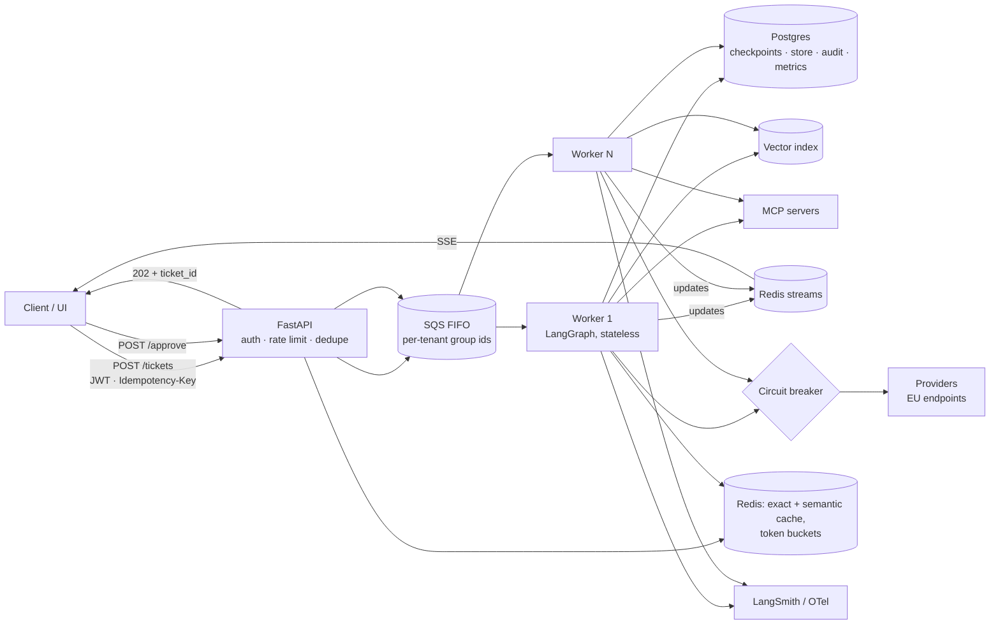

# Phase 8 — Production system design (Weeks 11–12)

## The goal

> **By the end of Week 12, `v0.8` exists: ATLAS as a multi-tenant service — FastAPI with JWT, idempotency, and rate limits; an SQS-backed worker pool running LangGraph statelessly; SSE event streaming; semantic + exact caching with correct keys; circuit breakers and per-tenant fairness; a local `docker-compose` stack; Terraform to an EU AWS region with canary deploy; a load test; a failure-modes table; and a measured cost per ticket by route.**

## Mental model

An agent request is a **long-running, expensive, partially-failing job**, not an HTTP call. Design it like a payments system: every action idempotent, every step durable, every failure isolated and observable, budgets enforced, circuit breakers everywhere, and a known cost per unit of work. The agent is just the worker at the end of the queue.



## Concepts

### Sync vs async, and why ATLAS does both
Chat wants tokens now; tickets want a queue and a callback. `POST /tickets` → 202 + id; a worker runs the graph; the client subscribes to SSE from a Redis stream or receives a webhook; `POST /tickets/{id}/approve` enqueues a resume. Chat-style interactions (FAQ route) can stay synchronous with streaming and a short deadline.

### Stateless workers, durable state
Workers hold nothing between steps; checkpointer + store hold everything. Any worker resumes any thread; deploys don't drain; crashes resume. It falls straight out of Phase 3 and it's the single most important design decision.

### Idempotency, three places
Client `Idempotency-Key` on submission (Redis SET NX with TTL); tool idempotency keys (Phase 4); `thread_id = ticket_id` so a redelivered message resumes instead of restarting. SQS FIFO deduplication is a fourth, cheap layer.

### Rate limiting, backpressure, fairness
Token buckets in Redis per tenant and per provider/model; queue depth as backpressure (429 at the API when depth exceeds a threshold); provider 429s → exponential backoff with jitter; **circuit breaker** per provider (open after N failures, half-open probe) → fallback model or "queued for human". Fairness: SQS FIFO message-group ids per tenant, or weighted round-robin across per-tenant queues, so one tenant's bulk submission can't starve another.

### Multi-tenancy
`tenant_id` in every state object, namespace, index filter, log line, metric label, audit row, cache key. Isolation tests from Phases 2/5 run in CI. Per-tenant budgets/quotas from Phase 6. Noisy-neighbor protection at the queue.

### Caching, three layers — and the keys
**Exact-match** response cache for FAQ: key = `(tenant, prompt_version, retrieval_version, normalized_query)`. **Semantic cache**: embed query; serve cached answer above a strict threshold; same key components plus embedding; log every semantic hit for offline judging (a wrong cached answer is the worst failure). **Provider prompt caching**: stable system prefix → cached input pricing; measure hit rate and savings.

### Timeouts, layered
Per LLM call, per tool, per node, per graph run (`recursion_limit` + wall-clock deadline carried in state), per queue message (visibility timeout > graph deadline, extended on long runs).

### Serving choices: API models vs self-hosting
Most enterprise ATLAS deployments use API models via EU endpoints. Self-hosting (vLLM/SGLang on GPUs, or Bedrock-hosted open models) makes sense for data-residency absolutism, very high volume, or fine-tuned models — at the cost of an inference-ops discipline of its own (batching, KV-cache, quantization, autoscaling). Know the trade-off and the numbers; ATLAS keeps a `provider=` switch so a self-hosted endpoint is a config change.

### Deployment shape
Services: `api`, `worker`, `mcp-it`, `mcp-kb`, `online-eval`, `extractor`. Infra: Postgres (checkpoints, store, audit, metrics), Redis (cache, buckets, streams, dedupe), SQS FIFO, vector index (pgvector to start), object storage, LangSmith EU or self-hosted Langfuse, OTel collector. Docker per service; Terraform for AWS `eu-central-1` (ECS Fargate or App Runner + Aurora Serverless v2 + ElastiCache + SQS); GitHub Actions: test → eval gate → build → deploy canary → promote. Managed alternative: LangSmith Deployment (formerly LangGraph Platform) runs the API/worker/persistence shape for you — know what it abstracts.

### Observability beyond traces
Structured logs joined by `trace_id`; metrics: queue depth, worker utilization, provider error/429 rate, cache hit rate, $/min; alerts tied to runbook entries; OTel GenAI spans from Phase 7 alongside infra spans.

### Cost model
`$ per ticket = Σ LLM calls × price + embeddings/rerank + infra per ticket`. By route. Optimization order: cache → route more to cheap model (with eval proof) → prompt caching → trim context → smaller reranker → batch offline work. Present it as a table; it's the number clients buy on.

## Resources

| # | Resource | Time | Extract |
|---|---|---|---|
| 1 | **Chip Huyen — inference optimization + architecture chapters** | 2.5 h | latency/cost/quality triangle; optimization order |
| 2 | **Kleppmann — DDIA ch. 8, 11** | 3 h | partial failure; message brokers; exactly-once is a lie |
| 3 | **LangGraph docs → Deployment concepts; LangSmith Deployment overview** | 1 h | how the API/worker/persistence shape is packaged |
| 4 | **AWS docs: SQS FIFO (dedup, group ids, visibility timeout); ElastiCache patterns; Aurora Serverless v2** | 2 h | the four settings that bite |
| 5 | **Provider prompt-caching docs (OpenAI, Anthropic)** | 30 m | prefix rules; pricing |
| 6 | **vLLM docs — production serving overview** | 1 h | what self-hosting costs in ops |
| 7 | **Your AWS course notes (Weeks 2–4)** | — | reuse Terraform, App Runner, Lambda, SQS patterns |
| 8 | Optional: **Google SRE book — ch. 4 (SLOs), 6 (monitoring)** | 1.5 h | SLO/alert discipline |

## Milestones

| Milestone | Deliverable | Done when |
|---|---|---|
| **M8.1 API** | `api/main.py`: JWT, buckets, idempotency, 202, SSE, approve | `curl` flows work locally |
| **M8.2 Worker** | `api/worker.py`: SQS consumer, stateless graph run, event publish, resume | two workers share a thread across a kill |
| **M8.3 Resilience** | `resilience.py`: circuit breaker, token bucket, dedupe, deadlines | unit tests; breaker half-open recovery demo |
| **M8.4 Fairness** | per-tenant group ids / weighted queues | tenant A bulk → tenant B p95 unchanged |
| **M8.5 Caching** | exact + semantic + provider prompt cache | hit rates logged; semantic hits judged offline |
| **M8.6 Local stack** | `infra/docker-compose.yml` | `docker compose up` → end-to-end ticket |
| **M8.7 Terraform** | `infra/terraform/` EU region | `terraform apply` → live ATLAS |
| **M8.8 Deploy pipeline** | `.github/workflows/deploy.yml` test → gate → build → canary → promote | one green run |
| **M8.9 Load test** | `load/locustfile.py`; report | 50 and 200 concurrent: p95, queue depth, 429s, $ burn |
| **M8.10 ARCHITECTURE.md** | diagram, components, failure-modes table, SLOs, $/ticket | reviewed |
| **M8.11 Ship** | write-up #8; tag `v0.8` | — |

## Day-by-day

| Day | Week 11 | Week 12 |
|---|---|---|
| Mon | M8.1 API · R2 (ch. 8) | M8.6 compose stack · R3 |
| Tue | M8.2 worker + SSE · R4 | M8.7 Terraform · R7 |
| Wed | M8.3 resilience · R2 (ch. 11) | M8.8 pipeline; canary |
| Thu | M8.4 fairness; M8.5 caching · R5, R1 | M8.9 load test · R8 |
| Fri | isolation + idempotency CI tests | M8.10 ARCHITECTURE.md; $/ticket table |
| Sat | break-it 1–3 · R6 | break-it 4–7; checkpoint |
| Sun | notes, rest | write-up, tag |

## Lab

### `atlas/api/main.py`
```python
@app.post("/tickets", status_code=202)
async def submit(t: TicketIn, p: Principal = Depends(auth), idem: str = Header(alias="Idempotency-Key")):
    if not await dedupe.claim(f"idem:{p.tenant}:{idem}", ttl=86400): return await existing(p.tenant, idem)
    if not await buckets.take(f"tenant:{p.tenant}"): raise HTTPException(429, "tenant rate limit")
    if await queue.depth() > MAX_DEPTH: raise HTTPException(429, "system busy, retry later")
    tid = new_id()
    await sqs.send(body={"kind": "run", "ticket_id": tid, "tenant": p.tenant, "user": p.user_hash, "role": p.role,
                         "text": t.text, "deadline": now() + 300}, group_id=p.tenant, dedup_id=f"{p.tenant}:{idem}")
    await dedupe.remember(f"idem:{p.tenant}:{idem}", tid)
    return {"ticket_id": tid}

@app.get("/tickets/{tid}/events")
async def events(tid: str, p: Principal = Depends(auth)):
    return EventSourceResponse(redis_stream_reader(f"events:{p.tenant}:{tid}"))

@app.post("/tickets/{tid}/approve")
async def approve(tid: str, d: Decision, p: Principal = Depends(auth)):
    await sqs.send(body={"kind": "resume", "ticket_id": tid, "tenant": p.tenant, "decision": d.value}, group_id=p.tenant)
    return {"ok": True}
```

### `atlas/api/worker.py`
```python
async def handle(msg):
    body = msg.body; cfg = {"configurable": {"thread_id": body["ticket_id"]}, "tags": [f"tenant:{body['tenant']}"]}
    graph = build(checkpointer, store)                   # stateless: everything is in Postgres
    inp = Command(resume=body["decision"]) if body["kind"] == "resume" else initial_state(body)
    async with visibility_extender(msg, every=60):
        async for ev in graph.astream(inp, cfg, stream_mode="updates"):
            await redis.xadd(f"events:{body['tenant']}:{body['ticket_id']}", {"event": json.dumps(ev)})
            if deadline_passed(body): raise Deadline()
    st = graph.get_state(cfg)
    if st.next == ("approval",): await redis.xadd(..., {"event": "awaiting_approval"})
    await msg.ack()
```

### `atlas/api/resilience.py`
```python
class CircuitBreaker:
    def __init__(self, fail_threshold=5, reset_after=60): ...
    async def call(self, fn, *a, **kw):
        if self.state == "open" and not self.due_probe(): raise CircuitOpen(self.name)
        try: r = await fn(*a, **kw); self.on_success(); return r
        except ProviderError: self.on_failure(); raise
# wrap provider calls: breaker("openai").call(chain.ainvoke, ...) with fallback to breaker("anthropic")
class TokenBucket: ...      # Redis Lua script: atomic take with refill
class Dedupe: ...           # SET NX EX; remember(key, ticket_id)
```

### Semantic cache (FAQ route)
```python
KEY = lambda tenant: f"semcache:{tenant}:{ACTIVE['faq']}:{RETRIEVAL_VERSION}"
async def lookup(tenant, query):
    q = embed([query])[0]
    hit = await redis_vec.search(KEY(tenant), q, threshold=0.93, k=1)
    if hit: audit("cache_hit", kind="semantic", tenant=tenant, score=hit.score); return hit.answer
async def store(tenant, query, answer): await redis_vec.add(KEY(tenant), embed([query])[0], answer, ttl=7*86400)
```
Every semantic hit is sampled into the Phase 7 online evaluator.

### `infra/docker-compose.yml` services
`postgres` (pgvector), `redis` (with search module), `localstack` (SQS), `otel-collector` + `jaeger`, `mcp-it`, `mcp-kb`, `api`, `worker` (×2), `online-eval`, `extractor`.

### `infra/terraform/` modules
`network` (VPC, private subnets), `data` (Aurora Serverless v2, ElastiCache, SQS FIFO + DLQ, S3), `compute` (ECS Fargate services: api, worker, mcp-it, mcp-kb, online-eval; autoscale workers on queue depth), `secrets` (Secrets Manager), `observability` (CloudWatch alarms → runbook links), region `eu-central-1` only, enforced by a policy check.

### `docs/ARCHITECTURE.md` — failure-modes table (excerpt)
| Component | Failure | Detection | Mitigation | Runbook |
|---|---|---|---|---|
| Provider | 429 storm | 429 rate metric | backoff → breaker → fallback model | RB-01 |
| Worker | crash mid-graph | message redelivery; checkpoint step | resume; idempotent tools | RB-02 |
| Queue | depth spike (tenant bulk) | depth per group | per-tenant groups; API 429 | RB-03 |
| Cache | stale answer after prompt change | key includes versions | versioned keys; TTL; judged hits | RB-04 |
| MCP server | down | health check; tool errors | degrade to human queue | RB-05 |
| Postgres | failover | connection errors | Aurora multi-AZ; retries | RB-06 |

## Level 2 — advanced extensions
1. **Self-hosted model path**: vLLM on one GPU instance (or Bedrock open model) behind the same interface; measure $/ticket and p95 vs API.
2. **LangSmith Deployment** trial: deploy the graph there; write one page on what it abstracts vs your Terraform.
3. **Priority lanes**: urgency 5 tickets bypass the backlog (separate queue or weighted scheduler).
4. **Chaos day**: scripted kills of worker/Redis/provider during a load test; record recovery times.

## Break it
1. Same ticket 5× in 1 s, same key. One run?
2. Provider rate limit set absurdly low. Breaker opens? Half-opens? User message sane?
3. Kill a worker mid-graph under load. Another picks up? Time to resume?
4. Tenant A 1,000 tickets. Tenant B p95?
5. Deploy a new worker version with 20 in flight. Lost? Duplicated?
6. Promote a new FAQ prompt. Old semantic-cache entries served? (Key must include version.)
7. Fill the semantic cache with a near-miss. Does a wrong answer get served? Tighten threshold; measure hit-rate cost.

## Checkpoint
1. Why is "stateless workers + persistent checkpoints" the key decision; what breaks otherwise?
2. Estimate cost at 10k tickets/day from your $/ticket; first optimization?
3. Why must visibility timeout exceed the graph deadline?
4. Where does an approval enter; why not straight to a worker?
5. When would you self-host a model for ATLAS, and what new ops burden appears?
6. What must a semantic cache key contain, and why is a semantic cache hit riskier than an exact one?

**Task:** ARCHITECTURE.md with the failure-modes table and load-test numbers; live in `eu-central-1` with one green canary.

<details><summary>Answer key</summary>

1. Horizontal scaling, crash recovery, zero-drain deploys, day-long approvals, time-travel debugging. In-memory state: crashes lose tickets mid-action, approvals can't span restarts, only the original worker can resume.
2. $/ticket × 10k; e.g. $0.08 → $800/day → ~$24k/month. First: cache the FAQ route (often 30–50% of volume) and route more to the cheap model with eval proof; then prompt caching.
3. Otherwise SQS redelivers while the first worker is still running → duplicate execution. Deadline < visibility; extend on long runs.
4. API → queue → any worker; the original worker may be gone; checkpoints make resume location-independent.
5. Residency absolutism, very high volume, or a fine-tuned model; you inherit batching, KV-cache, quantization, GPU autoscaling, and model-version drift on your own infra.
6. Tenant, prompt version, retrieval version, embedding; semantic hits can serve a confident wrong answer to a near-miss query — hence strict thresholds, TTLs, and judged samples.
</details>

## Write-up #8
*"Shaping an agent system like a payments system."* Architecture diagram, failure-modes table, load-test chart, $/ticket by route.

## Gate
**"I design and deploy multi-tenant, queue-backed, idempotent agent systems with stateless workers, circuit breakers, per-tenant fairness, versioned exact/semantic caching, IaC in an EU region, canary deploys, and a measured cost per unit of work."** → `git tag v0.8`
