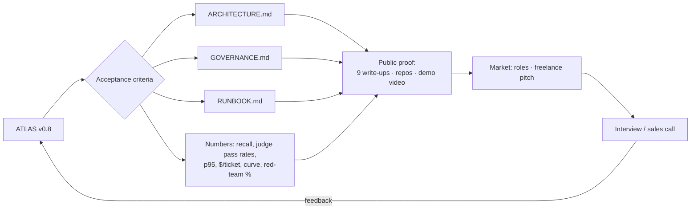

# Phase 9 — Capstone, proof, market (Week 13)

## The goal

> **By the end of Week 13, `v1.0` exists: every acceptance criterion below is true, nine write-ups are public, the MCP servers are open-sourced, a five-minute demo is recorded, and you can pass the 90-minute cold self-test.**

## Mental model

The capstone is not "finish the code". It's **convert the system into evidence**: numbers, documents, a demo, and a story you can tell in an interview or a sales call. Engineers are hired for what they can *defend*, not what they built.

## Acceptance criteria — all must be true

- [ ] 200+ pages ingested; recall@5 ≥ 0.85 and faithfulness ≥ 0.90 on a 50-question golden set
- [ ] Three routes with a data-driven routing table; one path requires human approval and resumes after a process restart
- [ ] Two MCP servers, one remote with auth; client allow-list, manifest pinning, audit
- [ ] Memory-on vs memory-off curve over 60 tickets shows improvement; namespace isolation tested in CI
- [ ] Guardrails handle ≥ 95% of the 60-case red-team set; taint-aware write denial demonstrated; GDPR erasure empties every store; GOVERNANCE.md with AI Act posture
- [ ] Judges validated (TPR/TNR ≥ 0.85); CI gate blocks a bad PR; registry with promotion/rollback; online evals with a drift alert; OTel GenAI telemetry
- [ ] Deployed to `eu-central-1` via Terraform; load-tested at 200 concurrent; dashboard with quality, p95, $/ticket, block rate per route; failure-modes table
- [ ] README with numbers; ARCHITECTURE.md; GOVERNANCE.md; RUNBOOK.md; 5-minute demo video

## Milestones

| Milestone | Deliverable | Done when |
|---|---|---|
| **M9.1 Criteria audit** | `docs/ACCEPTANCE.md` — each criterion with the evidence link | every box has a link, not a claim |
| **M9.2 README** | numbers table, architecture image, quickstart, links | a stranger runs it in 15 minutes |
| **M9.3 Demo** | 5-minute video: ticket in → trace → approval → resolution → dashboard | under 5:00; no dead air |
| **M9.4 Open source** | `kb-mcp` and `it-mcp` as separate repos, tests, README, license | green CI badges |
| **M9.5 Write-ups** | all nine published; German one-line summaries | links in README |
| **M9.6 Self-test** | 90 minutes, cold, recorded | all five answered without notes |
| **M9.7 Market kit** | CV lines from gate sentences; freelance one-pager; three target-role application drafts | reviewed |
| **M9.8 Ship** | tag `v1.0` | — |

## Day-by-day

| Day | Build | Write |
|---|---|---|
| Mon | M9.1 criteria audit; fix gaps | — |
| Tue | M9.2 README; M9.4 split repos | — |
| Wed | M9.3 demo recording | German summaries |
| Thu | M9.5 publish remaining write-ups | — |
| Fri | M9.6 self-test (record it) | notes on gaps |
| Sat | M9.7 market kit | — |
| Sun | tag `v1.0`; rest | — |

## The 90-minute cold self-test
1. Whiteboard ATLAS: all eight layers, the failure-modes table, the data flows a DPO would ask about.
2. A new model is 40% cheaper. Walk it into production safely, step by step.
3. A customer reports a cross-tenant data leak. Incident response, step by step, including which audit fields you need to even investigate.
4. Explain adaptive agents to a CFO in three sentences; then to a staff engineer in three.
5. Name the three most common ways teams fail at evals and what you do instead.

## Job roles this maps to (German market)

| Built | Job-ad language | Roles |
|---|---|---|
| P1–P3 | LLM integration, LangChain/LangGraph, RAG, structured output | AI Engineer, GenAI Engineer, LLM Engineer (mid-level) |
| P4 | MCP, tool integration, agent platforms | Agent Platform Engineer |
| P5 | agentic AI, memory, multi-agent, self-improving systems | Senior AI Engineer / Agentic AI Engineer |
| P6 | AI governance, EU AI Act, GDPR, responsible AI | AI Engineer at regulated companies |
| P7 | LLMOps, evaluation, observability | LLMOps / AI Platform Engineer |
| P8 | system design, cloud, Terraform | AI Solutions Engineer / Architect track |

Freelance units (Freiberufler pitch): RAG copilot with measured recall (P2), MCP integrations with auth and audit (P4), governance package — guardrails, audit, erasure, GOVERNANCE.md (P6). Price on $/ticket and hours saved.

## Write-up #9
*"ATLAS: what I built in 13 weeks and what the numbers say."* Link everything. This is the post you pin.

## Gate
**"I have built, evaluated, governed, deployed, and documented a production adaptive-agent system — and I can defend every layer of it cold."** → `git tag v1.0`
